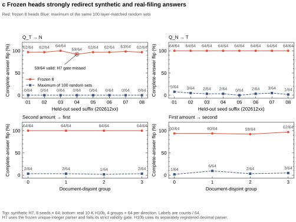
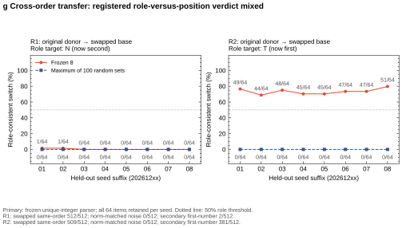

# Experiment 07 — Which number does the model choose?

**Replacing eight frozen Qwen3-4B attention-head outputs switches which of two supplied numbers it reports, in both directions: 1,008/1,024 original-order held-out answers and 497/512 answers on real 10-K sentences flip.** Across 100 layer-matched random head sets, the highest seed/group rates stay below 8% and 10%, respectively. Different-number donors switch 1,007/1,024 answers to the recipient passage's own alternative; no scored answer matched a donor value. Two pre-registered bars were missed: one held-out seed had 59/64 valid outputs against a 95% bar, and removing the heads cost 29.4 of the required 30 accuracy points. A pre-registered replication on eight fresh seeds then met the necessity bar (30.96 points) but again missed validity on one seed (60/64), so it fails as registered.

**Illustrative example:** a passage gives $931 million in past revenue and $237 million in guidance; replacing eight head outputs can make the model report the passage's other figure.

**Order-reversal check:** H11 is **mixed**: 2/512 and 376/512 role-consistent switches. These results do not establish role-only encoding.

## Question

Can a small set of heads change which supplied number the model selects, across new names, numbers, and question wording?

## Task

Contexts supply past revenue **N** and future guidance **T**. Questions ask for N (`Q_N`), T (`Q_T`), or a forecast (`Q_F`, intended answer T). The original template states N first and T second; H11 reverses those sentences.

The response starts with `$`; greedy decoding allows eight new tokens. The original scorer accepts one unambiguous integer, with optional units; extra numbers are invalid.

## Method in five lines

1. Use four dev seeds × 64 contexts; reserve eight seeds × 64 with disjoint names, integer values, and changed wording.
2. Scan full residual states to set a descriptive layer bound; rank all 768 heads (of 1,152 in the model; layers 0–23 scanned) by first-digit logit change.
3. Test the top 2, 4, 8, and 16 heads jointly; freeze the smallest qualifying set, eight, before held-out calls.
4. Replace head outputs at the final prompt position, before the output projection; compare 100 frozen, layer-matched random sets.
5. Test both directions, mean-ablation necessity, different-number donors, and matched-norm random vectors; retain invalid answers in denominators.

## Results

- **Localisation.** Clean accuracy is 256/256 per literal question. The residual scan first clears 80% bidirectionally at layer 23. L23H26 dominates single-head effects: 12.92 donor-oriented logits, averaged over four dev seeds and both directions. The frozen eight occupy layers 21–23. [Scan](figures/a_residual_scan.svg), [all heads](figures/b_single_heads.svg), [joint-k evidence](results/joint_k.json).
- **Held-out tests.** T→N flips **496/512 (96.9%)**; N→T flips **512/512 (100%)**. Each seed/direction beats its maximum of 100 random sets. Forecast transfer H9 flips **274/512 (53.5%)**, meeting its own rule, but only 274/512 outputs are valid. Under the frozen parser, 0/512 stayed T; a **post-hoc** first-integer parse gives 512/512 switches to N and does not change H9's verdict. [H7](results/h7.json), [H9](results/h9.json), [post-hoc counts](results/h9_secondary.json).
- **Selection-transfer control.** With different-number donors, outputs still switch to the base's own alternative: **495/512** T→N and **512/512** N→T. In both directions, no scored answer matched a donor value (**0/512** each); matched-norm noise flips are also **0/512** each. This supports transferable selection information. It does not establish that the head outputs contain no value information. It also does not establish a literal pointer or a complete circuit. [Controls](figures/d_mismatched_donor.svg).
- **Real 10-K transfer.** Without reselection, H10b flips **256/256 (100%)** second→first amounts and **241/256 (94.1%)** first→second amounts. All four document-disjoint groups beat their 100 random sets. These are DocFinQA training-set filing sentences with year-specific questions. Clean accuracy is 256/256 per question; this answer-redirection test makes no claim about downstream financial use. [Group evidence](results/h10b.json).
- **Role versus position (H11).** Swapped clean Q_N and Q_T are each **512/512** correct. With original-order donors and swapped bases, R1 (Q_N into Q_T, target N now second) switches **2/512 (0.4%)**; R2 (Q_T into Q_N, target T now first) switches **376/512 (73.4%)**. The registered verdict is **mixed**. Descriptively, in both cross-order directions the patched model mostly reports the guidance figure T (510/512 stay T in R1; 376/512 switch to T in R2), the same default seen under mean ablation. All random-set maxima are **0/64**, and matched-norm noise switches **0/512** in both directions. Swapped same-order controls switch **512/512** and **509/512**. The pre-registered secondary first-number parse gives **2/512** and **381/512** cross-order switches. [Per-seed scores and validity](results/h11_per_seed.csv), [gate and rule](results/h11.json), [figure](figures/g_role_position.svg).
- **Attention allocation.** Across 512 clean prompts per query, L23H26 allocates **35.1–51.1%** of attention to question tokens and **1.4–1.9%** to number tokens. L23H4 allocates **61.0–73.2%** to numbers. Other heads also attend to questions. Attention does not establish head-to-head connections. [Attention split](figures/e_attention_split.svg).
- **Exploratory 8B check.** Selection within the 8B model uses only four dev seeds and layers 20–23. On two held-out seeds, each direction flips **128/128**, versus **0/64** for each seed's maximum of 20 random sets. Six of eight selected indices overlap with 4B; single-head effects correlate at **Spearman ρ=0.8807 across 128 heads**. Shared training and [distillation](results/distillation_citation.json) could contribute; neither is an established explanation. [Scatter](figures/f_4b_8b_overlap.svg).



Red: frozen eight; blue: random maxima. Vertical axes: flip percentages; labels: counts/64. The circled seed fails H7 validity. Tasks use different registered parsers.



H11 reverses sentence order while retaining the same values and questions. Red: frozen eight; blue: random maximum. The vertical axis is role-consistent switch percentage; labels are counts/64. The same-order controls remain strong, while cross-order transfer is asymmetric.

## What did not pass

- **H7:** one of eight seeds has **59/64 valid outputs (92.2%, below 95%)** in T→N. Its five failures give the right figure, then a numeric fragment. The frozen verdict remains failed.
- **Necessity:** dev-mean ablation loses **301/1,024** correct answers, a **29.4 percentage-point** drop against a 30-point threshold. The drop is asymmetric: Q_N loses **26–32/64 (40.6–50.0 points)** per seed; Q_T loses **6–11/64 (9.4–17.2 points)**. With the heads mean-ablated, the model defaults toward the guidance figure. [Evidence](results/necessity.json).
- **H10:** a scorer bug for this task rejected decimals and commas, yielding **121/256** correct per query. H10 stopped before intervention. H10b registered its decimal-aware, first-number parser after that failure and before any intervention; it does not revise H10 or H7.
- **Anchoring:** none observed here. Clean forecasts select guidance in **256/256** 4B dev cases and **128/128** 27B pilot cases. The 27B result is behaviour only; the anchoring-rescue trigger never activates.

## Pre-registered replication

The two missed bars were retested on eight fresh seeds, 20261301–20261308, with every frozen element and rule unchanged. The [addendum](ADDENDUM_REPLICATION.md) was committed before any call on those seeds. Before it, a rerun of held-out seed 20261201 reproduced all 101 saved sets exactly. The original verdicts stand; this is a separate test.

- **Sufficiency (H7): failed again, on validity only.** T→N flips **494/512 (96.5%)**; N→T flips **512/512**. Every seed and direction beats its 100 random sets; the t(7) lower bounds are 0.951 and 1.0. Seed 20261302 has **60/64** valid T→N outputs, one short of the 61/64 bar. Pooled T→N validity is 494/512 (96.5%; Wilson 95%: 94.5–97.8%); over both directions it is 1,006/1,024 (98.2%). Of 18 invalid outputs, 16 give the correct N and then begin a second `$` figure; the other two are `35000000` and `192 million × 5 =`.
- **Necessity: passed.** Dev-mean ablation loses **317/1,024** correct answers, a **30.96-point** mean drop (seed-level bootstrap 95%: 29.98–31.93). Q_N loses 28–33/64 per seed; Q_T loses 6–12/64. All 100 random sets lose 0 points.
- **Replication verdict: failed**, because its registered pass rule requires both. Across all 16 held-out seeds, the necessity drop averages 30.2 points and T→N validity is 990/1,024; both sit close to their bars. The addendum stated this in advance: under the original estimates, both bars pass together in under one run in ten. [Numbers](results/replication.json).

## Limitations

Scope is two supplied numbers with different leading digits, short answers, and a fixed prefill. Real-text candidates were filtered before model calls. Role and position are confounded in original-order H7 and real-text H10b. H11 is mixed, so the transferred signal may depend on number position and cannot be described as role-only. Strong flips do not establish sufficiency under the failed gate, necessity, mediation, or a full circuit. The exploratory 8B run lacks a runtime weight/configuration hash binding; overlap is not independent replication.

## Reproduce

From the repository root, using Python with NumPy and Matplotlib installed:

```bash
python experiments/07_numeric_selection/post/make_figures.py
python experiments/07_numeric_selection/post/make_tables.py
(cd experiments/07_numeric_selection/results && shasum -a 256 -c checksums.sha256)
```

The [packet guide](results/README.md) maps figures to tables and raw hashes. Regeneration needs no model or network. GPU reruns need cached models, off-Git data, and the historical environment: see [protocol](DESIGN.md). The current FREEZE path is redacted; historical runners require original committed bytes.

## Pre-registration timeline

The checkpoints below precede the calls they govern; H10/H10b/H11 were added after earlier results were known. Order is attested by local commit times and server file times on 2026-10-18 and 2026-10-19; there is no third-party timestamp.

1. **DESIGN** — `17896752056a6b01375db23b1d6dd5e44e88b794`, before discovery.
2. **FREEZE** — `ef30672576004dbc511bf05e4b89f3067d0ebcf2`, before held-out calls.
3. **H9 script** — `427fc591ad18cc532be062e53837cccfc017dc16`, before forecast-transfer calls.
4. **H10 addendum** — `1a7dbe069146151e7b181695fe8e9829a1fdbfaf`, before real-text model calls.
5. **H10 grouping construction** — `5cddda2`: hash-mod-4 → deterministic subset-sum in hash order, before any H10 model call; this balances four document-disjoint groups of 64.
6. **H10b addendum** — `6375fe246a4984af0412086b42d55e8ee9675584`, after H10's gate failure, before any H10/H10b intervention.
7. **H11 addendum** — `796a89e`, after H7, H9 and H10b were seen, before any H11 model call; implementation `3696312`. [Registered rule](ADDENDUM_H11.md).
8. **Replication addendum** — `f73c6f2ed06db98bb06aaa94f6e546e368d3636c`, after all earlier results, before any call on seeds 20261301–20261308; runner `ab86ab5`. [Registered rule](ADDENDUM_REPLICATION.md).
